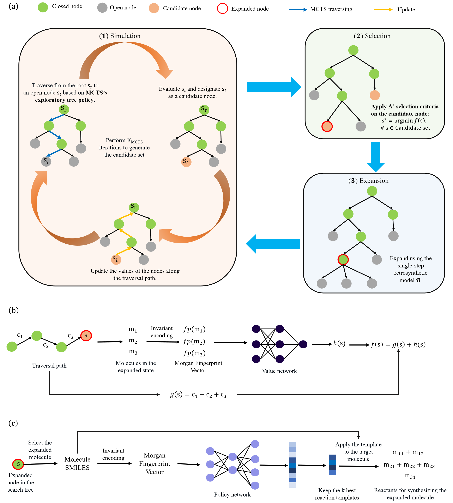

# Efficient retrosynthetic planning with MCTS exploration enhanced A* search

This is open-source codebase for MEEA*-PC (https://www.nature.com/articles/s42004-024-01133-2). MEEA* is proposed to incorporate the exploratory behavior of MCTS into A* by providing a look-ahead search. Path consistency is adopted as a regularization to improve the generalization performance of heuristics. Details about the search algorithm is summarized in the following figure.


Extensive experimental results on $10$ molecule datasets demonstrate the effectiveness of MEEA*. Moreover, for natural products, MEEA*-PC successfully identifies bio-retrosynthetic pathways for $97.68\%$ test compounds. Experiment results on each dataset is summarized in the following table:
|Dataset|Success Rate|Dataset|Success Rate|
|:-:|:-:|:-:|:-:|
|USPTO|$94.74\%$|logS|$80.34\%$|
|BBBP|$66.88\%$|ClinTox|$60.51\%$|
|logP|$73.72\%$|DPP4|$96.04\%$|
|BACE|$56.32\%$|Ames|$78.74\%$|
|Toxicity LD50|$72.94\%$|SVS|$73.01\%$|

## Requirements
rdkit==2022.9.3 

torch==1.13.1 

pandas==1.3.5

numpy==1.21.5

tqdm==4.64.1

rdchiral needs to be installed by
```
pip install -e rdchiral
```

## Testing
Download the building block molecules, and pretrained models from
<https://drive.google.com/file/d/1lXtRKRGETEYz0bTRAsl1LsBYGD20MM9O/view?usp=drive_link>

To test on regular organic molecule datasets
```
python MEEA_PC_parallel.py
```
To test on natural products
```
python MEEA_PC_NPs_parallel.py
```
## Policy backbone benchmark — SMILES vs fingerprint (desktop GPU)

The policy network of the paper reads a 2048-bit Morgan fingerprint. A fingerprint
has no meaningful token order, so a Transformer over fingerprint patches has no
sequence to attend to; a Transformer over **SMILES tokens** does. This benchmark
trains three backbones on identical data and reports top-1/10/50 and validation
loss for each:

| backbone | input | model |
|---|---|---|
| `mlp` | fingerprint bits | `RolloutPolicyNet` (the paper's) |
| `fp_transformer` | fingerprint patches | `TransformerPolicyNet` |
| `smiles_transformer` | SMILES tokens | `SmilesTransformerPolicyNet` |

### 1. Environment (CUDA desktop, once)

```bash
conda create -n meea-gpu python=3.10 -y && conda activate meea-gpu
pip install torch --index-url https://download.pytorch.org/whl/cu121
pip install -r requirements-gpu.txt
pip install -e rdchiral
python -c "import torch; print(torch.__version__, torch.cuda.get_device_name(0))"
```

### 2. Data

The benchmark reads three files under `prepare_data/`, which git does not track:
`policySmilesTrain.pkl.gz`, `policySmilesTest.pkl.gz`, `uspto_template.pkl.gz`.
Copy the first two from a machine that already has them (3 MB), or regenerate
them from `policyTrain/Test.pkl.gz` plus `data/uspto50k.tab`:

```bash
python scripts/build_smiles_policy_data.py
```

That recovers the SMILES behind every fingerprint row by re-fingerprinting the
products of `uspto50k.tab` and matching the packed bits, so labels and the split
stay exactly those of the original pickles. Rows absent from the 50k table are
dropped, leaving **35,634 train / 8,903 val** reactions over 14,407 templates —
the same subset for every backbone.

### 3. Run

```bash
python scripts/run_backbone_benchmark.py --epochs 100 --batch-size 512 --amp
```

Trains all three backbones in turn and writes `results/backbones/summary.md`.
A single backbone:

```bash
python scripts/compare_policy_backbones.py --model smiles_transformer --epochs 100 --batch-size 512 --amp
```

Flags: `--lr`, `--max-len` (SMILES truncation, default 160; the longest molecule
here is 153 tokens), `--num-workers`, `--device cuda:0`, `--out-dir`.
8 GB of VRAM is enough at batch 512 — drop to 256 if it ever runs out.

### 4. Output

Per backbone, under `results/backbones/`:

- `<model>.json` — config plus per-epoch `train_loss`, `val_loss`, `top1`,
  `top10`, `top50`, `elapsed_s`, and the best epoch under `best`
- `<model>.ckpt` — weights of the best top-1 epoch
- `smiles_transformer_vocab.json` — token vocabulary, needed for inference
- `summary.md` — the comparison table

Rebuild the table without retraining:

```bash
python scripts/run_backbone_benchmark.py --summary-only
```

Longer notes, including CPU reference numbers and why Apple MPS cannot run this,
are in [docs/gpu-benchmark.md](docs/gpu-benchmark.md).

## Citation
If you find this repo useful, please cite our paper:
```
@article{zhao2024efficient,
  title={Efficient retrosynthetic planning with MCTS exploration enhanced A* search},
  author={Zhao, Dengwei and Tu, Shikui and Xu, Lei},
  journal={Communications Chemistry},
  volume={7},
  number={1},
  pages={52},
  year={2024},
  publisher={Nature Publishing Group UK London}
}
```
## Acknowledgement

We appreciate the following github repos greatly for their valuable code base implementations:

<https://github.com/binghong-ml/retro_star>

<https://github.com/junsu-kim97/self_improved_retro>

<https://github.com/prokia/BioNavi-NP>
